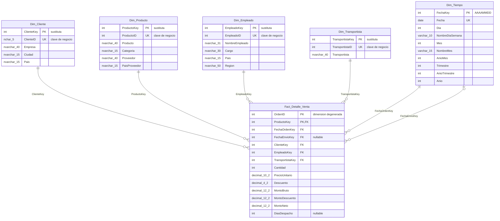

# Diagrama del modelo dimensional - Kent Foods

Esquema estrella, con `Fact_Detalle_Venta` al medio. Cada fila es un
producto vendido dentro de una orden. `Dim_Tiempo` aparece dos veces
porque se usa tanto para FechaOrden como para FechaEnvio.

## Claves

- Cada dimensión tiene una **clave sustituta** (`xxxKey`, `INT IDENTITY`)
  generada por el DW, y guarda el ID original como **clave de negocio**
  (`xxxID`, con restricción `UNIQUE`). El hecho solo usa las claves
  sustitutas; el ETL las obtiene con un *Lookup* por la clave de negocio.
  Así el DW no depende de cómo numera la base transaccional.
- `Dim_Tiempo` usa como clave la fecha en formato entero `AAAAMMDD`
  (ej. `20170115`). Es un calendario continuo, del 01-01-2016 al
  31-12-2018, que se llena con el procedimiento `dbo.usp_CargarDimTiempo`
  y tiene todos los días aunque no haya ventas.
- `OrdenID` queda en el hecho como **dimensión degenerada**: no tiene tabla
  propia, pero permite agrupar las líneas de una misma orden (por ejemplo,
  para el ticket promedio).

## Jerarquías para el cubo OLAP (Fase 2)

- Tiempo: Año > Trimestre > Mes > Día. Como Mes y Trimestre se repiten
  todos los años, en el cubo se usan `AnioTrimestre` y `AnioMes` como
  clave de esos niveles.
- Producto: Categoría > Producto
- Empleado: Región > Empleado

## Por qué estrella y no copo de nieve

Cada dimensión queda como una sola tabla: Categoría y Proveedor van
dentro de `Dim_Producto`, y Región dentro de `Dim_Empleado`, en vez de
hacerlas tablas aparte. Es más simple de cargar y de consultar (menos
joins), y es el mismo formato que usamos para los ejercicios Kollao del
curso.

## Notas que salieron de revisar la base original

- `Descuento` se normaliza a `DECIMAL(4,2)` en el ETL porque en el origen
  llega como `real` con errores de redondeo (0.15000001 en vez de 0.15).
- `FechaEnvioKey` y `DiasDespacho` quedan en NULL para las 21 órdenes (73
  líneas de `Fact_Detalle_Venta`) que todavía no se despachan.
- `MontoNeto` se guarda ya calculado (bruto menos descuento) para no
  tener que recalcularlo cada vez.
- Las medidas siempre usan `DetalleOrden.PrecioUnitario`, no
  `Productos.PrecioUnitario` (que es el precio actual), porque en 658 de
  las 2.155 líneas son distintos.
